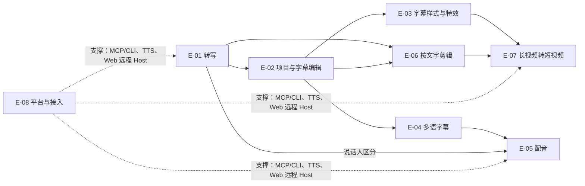

# 能力地图

把产品拆成 8 个 Epic。每个 Epic 再拆成可以独立发布的需求（F-编号），拆分规则见 [00-process/README.md](../00-process/README.md#大需求怎么拆)。

| Epic | 线 | 优先级 | 依赖 | 现状 |
|---|---|---|---|---|
| [E-01 转写](epics/E-01-transcription.md) | 底座 | P0 | — | 多 Provider（sherpa-onnx 内置、FlyCut Cloud、HTTP Provider），字词时间戳；缺中文口播质量基准 |
| [E-02 项目与字幕编辑](epics/E-02-subtitle-editing.md) | 字幕 | P0 | E-01 | 编辑、AI 纠错、SRT/VTT/ASS/JSON、硬字幕已有；缺项目管理（一个项目多个视频）、Host 持久化、自动保存 |
| [E-03 字幕样式与特效](epics/E-03-subtitle-effects.md) | 字幕 | P2 | E-02 | 样式和预设、三种画幅已有；缺动画 |
| [E-04 多语字幕](epics/E-04-multilingual-subtitles.md) | 字幕 | P2 | E-02 | 双语（`secondText`）已有；缺多语言轨道 |
| [E-06 按文字剪辑](epics/E-06-text-based-editing.md) | 剪辑 | P1 | E-01、E-02 | 删字幕剪视频、智能剪空白已有；缺统一时间映射、去口癖、导出剪映草稿 |
| [E-05 配音](epics/E-05-dubbing.md) | 字幕 | P3 | E-01、E-04、E-08 | 只有界面占位和 `tts` 模型角色 |
| [E-07 长视频转短视频](epics/E-07-long-to-short.md) | 剪辑 | P4 | E-03、E-06 | 没有 |
| [E-08 平台与接入](epics/E-08-platform.md) | 支撑 | 持续 | — | Host、Provider 体系已有；缺 MCP / CLI、TTS Provider 能力、Web 端连接远程 Host、崩溃收集 |

依赖列只写 Epic 之间的依赖；具体是哪个候选需求依赖哪个，见各 Epic 的候选需求表。

优先级的含义和每项的产品决定见 [decisions.md](../decisions.md#产品定位与优先级)。
