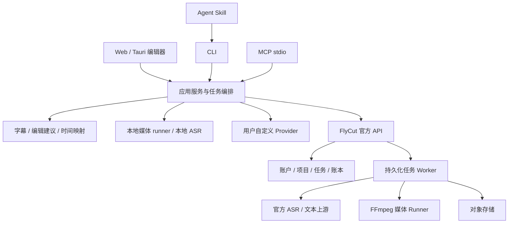

# FlyCut Caption 产品与实施计划

> 2026-11-09 变更：本地 WebAV / ffmpeg.wasm 导出回退已移除，Host 是唯一视频导出路径。本文中关于本地回退引擎的描述仅用于历史背景。

日期：2026-10-27  
状态：实施建议，尚未执行开发、采购或发布  
代码基线：`ad00f06` / `main` / `2.0.2`

## 1. 依据、已知约束与默认决策

参考对话「梳理项目方向 and 选型」中可读取的用户消息，以及本仓库源码。引用对话的助手回复仅返回内容引用，未取得正文，因此不把其中未知的选型或价格当作既定结论。用户已同意按以下方向制定计划：

- 专注 FlyCut Caption：字幕、口播清理、从已有长视频提取短片。
- 官方 API 作为默认在线 AI 服务入口；用户可切换自定义 API 或本地引擎。
- 提供 MCP 和 Skills，供其他 Agent 调用。
- 保留可独立运行的基础能力并开放源码；按后续确定的禁止改名要求采用自定义源码可见许可，通过托管服务及闭源集成商业授权获得收入。
- 沿用 `x007xyz/flycut-caption` 仓库，保留 Web、Tauri 桌面端和 React 组件库。

本计划不扩展到文生视频、图生视频、素材生成平台、多轨剪辑器或通用可视化工作流画布。内部允许声明式任务流水线，用于 Caption 自身的处理流程。

**首发目标：用户或 Agent 输入现有视频，完成识别、纠错、翻译、静音裁剪与字幕导出；用户能够逐项核对修改，选择在本地执行或购买官方服务。**

### 本计划采用的实施假设

1. 一名全职开发者，优先桌面端可靠性与本地 Agent 接入，Web 保留现有编辑和本地处理入口。
2. 首发支持中文、英文及中英双语；其它语言按服务商实际能力展示。
3. 第一版收费采用预充值余额/用量包，订阅在复购数据明确后再增加。
4. 首个商业版本只接一家官方 ASR 上游、一家官方文本模型上游；具体供应商通过样本测试和成本评估选定。
5. 不承诺未经测量的准确率、识别速度、硬件兼容性或云成本；性能和价格均需要后续验证。

## 2. 现状盘点：复用什么，补什么

以下为静态源码核查，尚未安装依赖或执行运行测试。

| 能力 | 当前代码证据 | 实施判断 |
|---|---|---|
| 浏览器 ASR | `src/services/asrService.ts`、`asrEngines/TransformersASREngine.ts` | 已有 Whisper/WebGPU/WASM 路径，保留 |
| 桌面 ASR | `FunASRTauriEngine.ts`、`src-tauri/src/commands/asr.rs`、FunASR sidecar | 已有原生路径，需要无界面调用边界 |
| AI 纠错与翻译 | `aiService.ts`、`OpenAICompatibleEngine.ts`、`useAI.ts` | 已支持自定义 baseUrl、API Key、模型；需要批次、取消、严格响应校验 |
| 双语与字词编辑 | `src/types/subtitle.ts`、`historyStore.ts`、字幕编辑组件 | 已有句子/字词及主副字幕结构，继续演进 |
| 静音裁剪 | `src/utils/smartCutBlank.ts`、`timeUtils.ts` | 已有规则与测试；需要统一时间映射和编辑建议模型 |
| 视频导出 | `UnifiedVideoProcessor.ts`、`videoEngines/*`、Rust video command | 已有 WebAV/FFmpeg 路径；现有 Blob/浏览器接口不能直接作为服务器契约 |
| npm 组件 | `src/index.ts`、`vite.config.ts` library 模式 | 保持 `@flycut/caption-react` 导出兼容 |
| 桌面发布 | `.github/workflows/release.yml` | 已覆盖 macOS arm64、Windows x64；其它平台不作为已支持承诺 |
| 测试 | `tests/*`、FunASR sidecar 测试 | 已有基础和依赖模型的集成测试，需要报告通过/跳过/未运行 |
| Agent 接入 | 未发现 MCP 服务端或独立 CLI | 新增；不能直接把 React Hook 暴露成 API |
| 官方云服务与商业系统 | 未发现完整账户、任务队列、计费账本 | 新增，现有网站不是现成后端 |
| 项目持久化与批处理 | 编辑状态主要在前端 store | 需要项目格式、资产引用、任务存储、并发隔离 |

### 先处理的具体问题

- `useAI.ts` 从全局 store 读写字幕，`AIService` 使用单一可覆盖的进度回调；无法安全支撑并行项目和多个 Agent 任务。
- AI 引擎一次发送全部字幕；响应只核对条数，缺少 ID 唯一性、集合一致性、字段类型和局部失败校验。
- 当前 `AIModelConfig.apiKey` 随 `aiModels` 被 Zustand 持久化；桌面凭证需迁到系统安全存储，Web 默认仅会话保存。
- `TODO.md` 将已实现的翻译、双语、桌面能力仍列为待办，并保留 Electron 路线；需要按代码重建任务清单。
- `pnpm-workspace.yaml` 指向不存在的 `packages/react`；`src/index.ts` 导出的版本仍为 `1.0.0`，与 package/Cargo 的 `2.0.2` 不一致。
- 协议按用户后续要求调整为自定义源码可见社区许可＋独立商业授权：禁止改名，闭源集成需事先购买商业授权；不再标注为标准 AGPL 或 OSI 认可的开源许可。发布前需完成 `docs/LICENSE-MIGRATION.md` 中的权利来源核查和发布检查。历史版本仍适用原许可。

## 3. 用户与产品范围

### 首批用户

1. 口播创作者：录完一段视频后，快速去空白、纠错、加双语字幕并导出。
2. 课程/访谈运营者：给已有长内容加字幕，后续从中挑选可单独发布的短片。
3. Agent 使用者：让 Codex 等宿主调用本地媒体处理能力，得到可编辑项目及实际文件。

第一版主路径：

```text
导入视频 → 选择执行方式 → 识别 → 核对/纠错 → 翻译（可选）
         → 查看裁剪建议 → 调整字幕样式 → 预览 → 导出
```

Agent 路径：

```text
创建项目 → 转录任务 → 获取字幕 → 提交修改建议 → 应用指定版本
        → 导出任务 → 获取 SRT/MP4/项目文件与执行报告
```

### 首发明确后置

- 自动精彩片段推荐、竖屏主体跟随、说话人分离：首发后单独验证。
- 去口癖、重录片段选择：先提供带原文和时间范围的建议，验证后再开放自动应用。
- 团队实时协作、素材市场、远程 MCP、多家非兼容协议适配：后置。

## 4. 免费、付费与接口边界

原则：**本地软件能力与自动化入口按社区许可开放；官方托管资源与闭源集成授权分别收费。** “高级”描述复杂度，不等于必须收费。

软件社区许可采用 FlyCut Caption 自定义源码可见许可：不允许改名，分发和修改版网络服务须按协议提供源码，闭源集成须事先取得独立商业授权，购买授权不自动获得改名权。普通企业使用、商业成片及独立 API/CLI/MCP 调用本身不自动需要购买集成授权。具体见根目录 `LICENSING.md` 和 `COMMERCIAL-LICENSE.md`。软件授权收入与下表的服务用量收入分别核算；React 组件库也适用当前社区许可。

| 功能 | 社区许可/自托管/本地 | 官方托管服务 | 对外能力标识 |
|---|---|---|---|
| 导入、项目保存、字幕编辑、撤销 | 免费 | 云存储后续按空间/时长收费 | `projects`、`transcripts` |
| 本地 Whisper/FunASR | 免费，用户承担设备与模型下载 | 不消耗官方余额 | `transcribe` |
| 官方云 ASR | 可选接入，需官方额度 | 按输入音频时长收费 | `transcribe` |
| 自定义 ASR API | 适配器及配置免费，外部服务费用另付 | 不收取官方模型调用费用 | `providers`、`transcribe` |
| 纠错、翻译、自定义文本 API | 功能免费，用户承担第三方费用 | 官方调用按文本用量收费 | `correct`、`translate` |
| 双语、字幕样式、SRT/JSON 导出 | 免费 | 单独导出字幕不额外收费 | `export_subtitles` |
| 本地静音裁剪与硬烧 MP4 | 免费，无付费清晰度锁 | 云渲染按执行规格与时长收费 | `detect_silences`、`render` |
| MCP、CLI、Skills、基础批处理 | 免费 | 只对实际使用的官方资源收费 | 相同任务接口 |
| 精彩片段推荐/去口癖（后续） | 算法源码与 BYOK 按社区许可开放 | 官方推理和渲染收费 | `suggest_clips`、`suggest_edits` |
| 高并发、托管批处理、长期存储 | 自托管自行配置 | 付费服务配额 | `jobs`、`assets`、`usage` |
| 团队管理、优先支持（后续） | 不作为首发依赖 | 商业服务 | 后续另定 |

### 收费模型与上线条件

- 第一版展示独立计价项：ASR 分钟、文本处理量、云渲染分钟与规格、超出免费保留期的存储。
- 用户看到余额、任务估价上限、执行位置与历史扣费；预估不是最终账单。
- 后端在开始执行前冻结额度，结束后按实际用量结算并释放剩余额度。
- 输入验证失败、未启动、取消、上游失败、部分完成分别定义结算规则；不得统一视为全额成功收费。
- 重复提交、任务重试、回调重放只能产生一次对应的结算记录。
- 接入一家支付渠道即可；使用官方签名校验回调，并建立订单、支付、账本对账流程。支付商与可售地区在实施前确定。
- 定价是后续实验，不在没有实测成本时承诺具体套餐。单任务贡献毛利需扣除 ASR/LLM、转码、存储流量、支付手续费和可归因重试成本。
- 内测门槛：样本用量成本可解释、估算与结算差异可追踪、正常任务贡献毛利为正；规模化前再设定明确毛利目标。

## 5. 默认官方 API 与用户自定义接口

### 三种执行配置

| 模式 | 行为 | 首次配置 |
|---|---|---|
| 官方服务（默认在线推荐） | FlyCut 后端持有上游凭证，执行并计费 | 登录、查看用量规则；额度不足提示充值 |
| 自定义服务（BYOK） | 用户指定 endpoint、model、凭证；默认不经过 FlyCut 云 | 测试连通性及能力，显示数据发送目标 |
| 本地模式 | 本地 ASR、本地裁剪和导出；文本能力按本地服务能力提供 | 下载模型、检查运行环境 |

“默认官方”不表示打开文件即上传，也不表示社区版必须登录。提交任务前显示发送内容：ASR 发送音频，翻译发送字幕文本，云渲染发送视频与字幕。用户选过的模式持久化。

发生错误时禁止静默从本地/BYOK 切到收费云服务，或从官方服务切到另一个数据目的地。提供明确的重试或切换入口。

### Provider 契约

至少定义：`id`、`kind`、`capabilities`、`endpoint`、`credentialRef`、`model`、`timeout`、`maxConcurrency`。

能力分别声明：词级时间戳、句级时间戳、语言、最大输入、异步任务、取消、用量返回、说话人分离。缺失词级时间戳时只提供句级裁剪，不伪造“精确字级”能力。

适配层拆分：

- `TextProvider`：纠错、翻译，首先复用现有 OpenAI compatible 文本协议。
- `TranscriptionProvider`：音频上传、识别结果及时间戳归一化；文本协议兼容不等于 ASR 协议兼容。
- `RenderExecutor`：桌面/CLI 原生 FFmpeg、WebAV、云端渲染。
- `CredentialStore`：桌面安全存储、CLI 环境变量/安全存储、Web 会话凭证；项目导出只保留引用。

官方上游选择采用同一测试集：中文口播、中英混合、噪声、长录音、专有名词；比较识别质量、词级时间戳、实际延迟、成本、重试与删除策略。先选一家完成闭环，再扩多家。

## 6. 技术架构与仓库演进

### 核心决策

- 继续使用当前 React/Vite/Tauri/Rust 技术栈，不重写编辑器。
- 先把纯数据操作和执行契约提取出来，逐模块迁移；不先做全仓目录搬迁。
- GUI、CLI、MCP、HTTP 共同调用应用服务；分别承担展示、传输和授权。
- 第一版任务流水线固定为声明式步骤，不执行用户提交的任意代码或 shell 字符串。
- 官方服务先用模块化单体 API、关系数据库、对象存储、独立媒体 worker；媒体转码在具备 FFmpeg 的进程/容器中执行。
- 任务初期可用数据库持久化队列和租约；需要独立队列时替换执行层，不改变公开任务协议。

### 渐进目录方案

```text
src/                         保留当前 GUI、React 组件导出、运行时适配
packages/contracts/          Schema、错误码、任务/项目/Provider 类型
packages/core/               字幕操作、编辑建议、时间映射、项目迁移；无 React/DOM
packages/application/        项目服务、任务编排、Provider 注册、执行器接口
packages/cli/                本地项目/任务/文件命令
packages/mcp/                Agent 工具适配，复用 application
src-tauri/                   桌面宿主与现有 sidecar
crates/media-core/           按需从 Tauri 提取的 FFmpeg/媒体能力
crates/media-runner/         CLI/worker 可执行进程，接收结构化任务
services/api/                官方 HTTP API、认证、用量、支付、任务控制
services/worker/             官方 ASR/文本/渲染任务执行
skills/flycut-caption/       安装说明、调用规范、流程示例
```

目录为目标结构，不要求在第一阶段全部创建。`packages/react` 当前配置需要先纠正，避免让新结构依赖一个不存在的包。

### 无界面执行的关键约束

现有 Tauri command 依赖应用宿主，前端导出接口返回 Blob；不能直接由普通 Node CLI 或云端调用。先定义文件/流式产物接口，再提取 Rust 媒体核心和 runner，保留 Tauri 适配器。FunASR sidecar 的模型定位、FFmpeg 路径、进度、退出码、取消与清理也需一并实现。

Web 保留浏览器执行器，CLI/云端使用原生 runner。首次可自动化发布先覆盖 macOS arm64 与 Windows x64；Linux worker 需单独完成镜像和实际媒体用例验收。



## 7. 数据模型、时间轴与任务契约

### 项目数据

- `Project`：schemaVersion、projectId、revision、媒体资产引用、语言、字幕、样式、编辑决策、来源信息。
- `Transcript`：句子及稳定 ID，词级时间戳可选；记录引擎与模型信息。
- `EditDecisionList`：相对原始媒体的保留/删除区间、原因、产生方式、审核状态。
- `TimeMap`：源时间到导出时间的映射；字幕必须与最终保留片段一起变换。
- `Artifact`：字幕/项目/视频，包含格式、校验值、大小、位置及有效期。
- `Job`：taskId、tenantId（云）、projectId、expectedRevision、操作、执行位置、输入、状态、阶段、产物、用量、错误。

先保持现有前端秒制时间戳，通过契约适配到统一整数毫秒；不要在迁移中混用秒与毫秒。句子/词关联 ID 必须跨纠错、翻译、裁剪保持稳定。

### 状态与一致性

```text
queued → running → succeeded / failed
                 → cancel_requested → cancelled / succeeded / failed
```

取消与成功存在竞态，应由执行层确认最终状态；不将“收到取消请求”当作已停止计费或已清理文件。失败任务的重试创建关联 attempt，保留原始输入与版本。

- 修改项目要求 `expectedRevision`，版本冲突返回可处理错误，避免 Agent 覆盖人工编辑。
- 文本 AI 结果先形成 patch 与 diff；严格验证 ID 集合、重复 ID、字段类型、批次完整性后再提交。
- 长字幕按上下文预算分批，邻近文本仅作为上下文，不重复写回；每批可重试并记录成功范围。
- 纯文本纠错不修改时间戳；删除口癖属于独立剪辑操作。
- 导出在任务开始时冻结输入项目版本，后台编辑不影响该次产物。
- 每个任务拥有独立进度和取消控制，替代全局单一回调。

## 8. 对外 API、MCP 与 Skills

下列均为拟定接口，不是仓库现有接口。

### HTTP API v1

| 方法与路径 | 用途 |
|---|---|
| `GET /v1/capabilities` | 可用操作、Provider、语言和限制 |
| `POST /v1/assets/uploads` | 申请短期上传凭证 |
| `POST /v1/assets/{id}/complete` | 确认资产、校验大小/哈希，开始媒体探测 |
| `DELETE /v1/assets/{id}` | 删除允许删除的资产并返回清理状态 |
| `POST /v1/projects` | 建立云项目或导入指定 schema 的项目 |
| `GET /v1/projects/{id}` | 获取项目与 revision |
| `POST /v1/projects/{id}/patches` | 带 expectedRevision 应用编辑补丁 |
| `POST /v1/quotes` | 根据资产与操作得到报价、上限及有效期 |
| `POST /v1/jobs` | 提交转录、纠错、翻译、裁剪分析或渲染 |
| `GET /v1/jobs/{id}` | 获取状态、阶段、错误、产物和用量 |
| `POST /v1/jobs/{id}/cancel` | 请求取消 |
| `GET /v1/artifacts/{id}` | 获取元信息及短期下载地址 |
| `GET /v1/usage` | 查询用量和账单明细 |
| `GET /v1/balance` | 查询可用与冻结余额 |
| `POST /v1/checkout-sessions` | 创建充值订单的支付会话 |
| `POST /internal/payments/webhook` | 支付渠道签名回调，不对 Agent 暴露 |

`POST /v1/jobs` 统一接收 `operation`、`projectId`、`expectedRevision`、`assetId`、`execution`、`options`、`quoteId`、`maxCost`。变更请求支持 `Idempotency-Key`。

云 API 只接受账户有权访问的资产 ID，不能接收调用者的本地路径。MVP 使用上传凭证，不开放任意 URL 下载。错误返回稳定错误码、retryable、stage、requestId；不得直接回传上游带敏感信息的响应。

### MCP 首发工具

第一版使用本地 stdio 传输，stdio 的 stdout 只输出协议数据；日志写 stderr。远程 MCP 与其认证体系后置。所有长任务立即返回 taskId，通过查询工具获取结果。

| 工具 | 行为 |
|---|---|
| `caption_capabilities` | 查询环境、Provider 和支持的操作 |
| `caption_create_project` | 从授权目录下的媒体文件创建项目 |
| `caption_get_project` | 获取项目摘要、版本和产物 |
| `caption_get_transcript` | 分页获取字幕，避免长视频耗尽 Agent 上下文 |
| `caption_transcribe` | 提交本地/BYOK/官方识别任务 |
| `caption_correct` | 提交纠错，默认产出待审核 patch |
| `caption_translate` | 提交翻译，保留原文 |
| `caption_detect_silences` | 得到裁剪建议、原因和时间区间 |
| `caption_apply_patch` | 按指定项目版本应用建议 |
| `caption_export` | 导出字幕或提交视频渲染 |
| `caption_get_job` | 查询进度和结果 |
| `caption_cancel_job` | 请求取消 |

本地文件访问限制在用户配置的工作目录及输出目录，解析真实路径以防符号链接越界；默认不覆盖源文件。云执行遵守预设预算与上传授权策略；已授权的批处理无需逐条人工确认。

### CLI 与 Skill

CLI 拟定命令：`caption doctor`、`project create/show`、`transcribe`、`correct`、`translate`、`silence detect`、`patch apply`、`export`、`job get/cancel`。

要求：`--json`、稳定退出码、输入文件/标准输入、任务恢复、明确输出路径；与 MCP 共用应用服务。MCP 调用能力可以直接链接应用服务，避免重复解析 CLI 文本。

Skill 提供安装与环境检查，以及三套明确流程：

1. 视频加字幕：创建项目 → ASR → 纠错 diff → 导出 SRT/带字幕视频。
2. 口播清理：识别 → 静音建议 → 应用裁剪 → 预览/报告 → 导出。
3. 双语发布：主字幕 → 翻译 → 双轨编辑/样式 → 导出。

Skill 不是运行时，不在其中复制实现、不携带密钥；不得把素材字幕中的文字当作操作指令。

## 9. 分阶段执行与验收

估算按一名熟悉项目的全职开发者计算，核心商业内测约 12–14 周，含集成缓冲约 14–17 周。以阶段验收决定进入下一阶段，不以日期替代验证。长视频切片另加约 3–4 周。

### P0：基线与范围锁定（约 0.5–1 周）

交付：纠正过期 TODO/文档、建立 capability 清单、统一版本来源、修正 workspace 配置，记录现有构建与用例结果。

建立至少 12 段经授权的测试素材：中英口播、中英混合、噪声、静音、短片、30–60 分钟长片；同时覆盖句级/词级时间戳结果、删除后双语导出。

验收：每个现有能力标明“运行通过/失败/未验证”；模型依赖缺失明确为跳过；Web、桌面、组件库的构建路径和现有缺陷可追踪。

### P1：项目与独立应用服务（约 2 周）

交付：contracts/core/application 初始层、版本化项目文件、项目保存恢复、编辑 patch、源/目标时间映射、任务状态与独立进度。

迁移优先顺序：时间/字幕纯函数 → 静音检测 → 纠错翻译编排 → GUI 接入；保留已有组件导出和历史操作。

验收：同一项目经过 GUI 和无 React 服务调用得到等价字幕与裁剪结果；任务互不覆盖进度；过期 revision 被拒绝；退出后可恢复项目；裁剪后字幕时间与输出对应。

### P2：Provider 与可靠文本处理（约 2 周）

交付：三种执行模式配置、能力发现、凭证存储、BYOK 文本适配、ASR 适配契约、分批/校验/超时/取消/限流/重试、纠错 diff。

官方 Provider 此时可使用契约测试桩，真实官方 endpoint 在 P4 接入，避免前端伪装已有云服务。

验收：长字幕不会一次塞入模型；429、超时、乱序、重复/缺失 ID、无效 JSON 均有明确处理；失败不破坏原文；日志、项目文件、普通配置导出不包含密钥。

### P3：本地 CLI 与原生 Runner（约 2–3 周）

交付：从 Tauri 提取可复用媒体能力，原生 runner、结构化进度、CLI、doctor 命令；提供 ASR → 翻译 → 裁剪 → 导出的固定流水线。

验收：关闭 GUI 后，CLI 可处理真实媒体并输出 SRT、双语 MP4、项目文件及机器可读报告；可取消和清理临时文件；macOS arm64/Windows x64 有可安装产物；源文件保持可恢复。

### P4：官方 API 与计费最小闭环（约 3 周）

交付：账户/API Token、上传、任务数据库/租约、worker、对象存储、真实 ASR/文本上游、报价、冻结/结算账本、充值支付、用量页、云任务删除策略。

拆分上线顺序：云转录与文本 → 计费和支付 → Linux 媒体 runner 验证 → 云渲染。若云渲染超出排期，首个付费版本只提供云 AI + 本地导出，并明确能力。

验收：跨租户访问被拒绝；重复支付回调与重试不重复入账/扣费；worker 崩溃后可恢复或明确终止；余额不足不执行收费任务；没有预算授权不扩大支出；临时资产按策略删除。

### P5：MCP 与 Skills（约 1–1.5 周）

交付：本地 stdio MCP、上述工具、分页、任务轮询/取消、Skill 安装文档及三套示例。

验收：至少在 Codex 与另一种 MCP 宿主完成“视频 → 双语字幕 MP4”；不靠界面点击；断开宿主后任务状态仍可查询；路径越界失败；本地/BYOK/官方执行位置和费用可辨认。

### P6：内测与商业发布准备（约 1–1.5 周）

交付：10 位左右真实创作者/Agent 使用者内测、任务漏斗、失败分类、成本报表、安装与恢复文档、发布检查表。

验收目标：测试集关键路径全部达到既定结果；付费任务账本完整；无已知数据覆盖/跨租户/重复扣费问题；内测用户能独立完成首个产物。若失败集中于识别质量或导出，同阶段修复，不扩功能。

### P7：长视频转短片（首发后约 3–4 周）

先文本选段，后视觉重构：

1. 从带时间戳的完整字幕分章，生成候选段落、原文引用、主题、建议标题和选择理由。
2. 强校验每个片段来自源时间轴、时长范围有效、段落可独立理解；评分用于排序，不宣称预测流量。
3. 用户/Agent 选择候选片段，生成子项目，继承字幕样式及时间映射，批量渲染。
4. 第一版竖屏使用手动/固定裁切与留边适配；人物跟随另立验证任务。

验收：一段 30–60 分钟素材产生可核对原文的候选片段；每个产物字幕和切点一致；至少约一半候选被目标内测用户认为只需少量修改即可使用，此阈值作为产品实验目标而非质量承诺。

## 10. 验证、发布与运营指标

### 必要工程验证

- 每次变更运行对应单元/契约测试；业务测试导入生产函数，避免只测试复制到 tests 下的算法。
- 字幕与时间映射：重叠、片头/片尾、跨裁剪边界、零长度、长片精度、双语与字体回退。
- Provider：服务能力缺失、认证错误、429、重试、取消、不同时间戳粒度、JSON 响应污染。
- 任务与计费：重复请求、网络断开、进程重启、取消竞态、失败结算、支付回调重放、租户隔离。
- 媒体端到端：真实编码文件的时长、音画同步、字幕落点、中文字体、输出可播放；不只检查文件存在。
- 桌面改动依照 AGENTS.md 执行 sidecar 构建、Cargo check、TS 类型检查；Web/库分别构建。
- 发布前单独核查模型、字体、FFmpeg 分发所需声明及当前 LICENSE/包元数据一致性。

### 产品指标

| 指标 | 目的 |
|---|---|
| 导入后成功导出比例、首个产物耗时 | 判断主流程是否可用 |
| ASR/翻译/渲染失败率，按执行器和模型分组 | 定位失败根因 |
| 字幕人工修订量、裁剪建议接受率 | 判断自动化是否节省工作 |
| Agent 完成率、每任务工具调用量 | 判断 Agent 接入是否真正可用 |
| 云试用到充值、充值到复购、周重复使用 | 判断收费需求 |
| 单任务收入、资源成本、失败成本、贡献毛利 | 判断盈利可持续性 |

匿名本地使用不默认上传媒体或字幕来做分析；观测使用任务状态、时长与错误分类，敏感日志须脱敏。

## 11. 风险、取舍与阶段止损

| 风险 | 对应措施 |
|---|---|
| 重构拖延交付 | 只提取本阶段需要的核心，保留现有 GUI 与 npm 入口 |
| 云 API 变成纯转售且利润低 | 以可编辑字幕、可靠裁剪、双语导出与 Agent 自动化形成完整结果；先验证复购 |
| 长视频失败/内存占用 | 文件式原生处理、分块任务、断点信息；Web 与桌面限制分别展示 |
| 删除后字幕漂移 | 统一 EditDecisionList 与 TimeMap，并以真实媒体回归 |
| AI 修改含义或错删口播 | diff、原文引用、版本化 patch、撤销；语义裁剪后置 |
| 接口扩展失控 | 首发一个文本兼容协议和一个云 ASR，能力检测先于扩供应商 |
| 免费与付费边界不清 | 能力矩阵公开；BYOK 和本地不暗中消耗官方余额 |
| 多租户/支付/文件路径问题 | 将其作为云和 MCP 阶段的具体验收，而非发布后补救 |

若 P6 尚不能让用户稳定导出或成本无法解释，暂停 P7，把资源用于主流程和计费可靠性。若用户持续选择 BYOK 且官方服务缺乏复购，先验证托管批量任务、企业支持等实际需求，再投入复杂订阅和团队协作。

## 12. 第一批可直接进入开发的任务

1. **CAP-001**：记录三条现有基线（Web、Tauri、React 库）及真实媒体输出，不把跳过写成通过。
2. **CAP-002**：纠正 workspace、版本来源与 TODO；保留功能兼容。
3. **CAP-003**：定义 Project/Transcript/EditDecisionList/TimeMap/Job Schema 与版本迁移策略。
4. **CAP-004**：提取生产字幕/静音/时间映射纯函数，用现有素材建立结果回归。
5. **CAP-005**：新增与 React 无关的 ProjectService/TaskService，使用每任务进度与取消。
6. **CAP-006**：迁移纠错翻译编排，加入分批、ID 校验与可审核 patch。
7. **CAP-007**：定义 Provider/Executor/CredentialStore，提供本地与 BYOK 适配；官方服务使用显式测试桩。
8. **CAP-008**：定义无界面 runner 协议并验证一个真实 ASR/FFmpeg 调用，为 CLI 与 MCP 铺路。

依赖：CAP-001 → CAP-002/003 → CAP-004/005 → CAP-006/007 → CAP-008。具体支付渠道、云部署商、上游模型和最终价格在相关阶段用样本与实测成本决定，不阻塞第一批任务。
