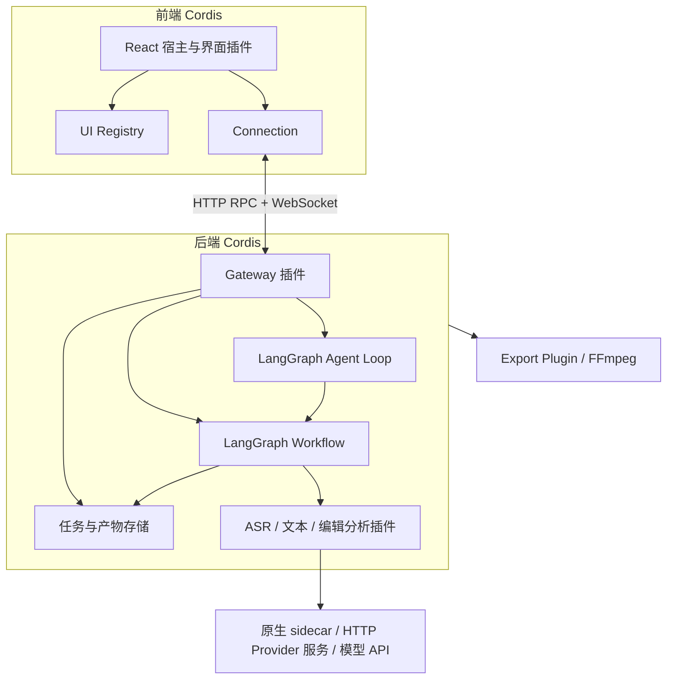

# FlyCut Caption：Cordis 前后端与 LangGraph 编排

本页描述当前代码。前端与 Host 是两个独立进程、两个 Cordis Context，通过 HTTP RPC 和 WebSocket 通信。客户端不带 Python；Python 推理（例如 FunASR）是用户自己运行的 HTTP Provider。

## 代码入口

| 路径 | 职责 |
|---|---|
| `core/cordis`、`core/cosmokit` | Harness 使用的真实 Cordis 源码，非自行实现的替代品 |
| `core/UPSTREAM.md` | 固定来源提交、许可证和本地打包调整 |
| `shared/protocol.ts` | 类型化 RPC 方法表 `RpcMethods`、可跨进程事件 `RemoteEvents`、任务与 ASR 请求契约 |
| `shared/asr`、`shared/editing`、`shared/text`、`shared/providerCatalog.ts` | 前后端共用的纯逻辑与 Provider 目录数据 |
| `src/runtime/client.ts` | 前端 Cordis 组装：UI 注册表（多贡献）、`ctx.asr`/`ctx.ai` 服务、Host 导出引擎注册 |
| `src/runtime/ui.tsx` | React 与 Cordis 的生命周期桥接、类型化 PluginSlot |
| `src/runtime/connection.ts` | 类型化 RPC、资产上传下载、WebSocket 事件订阅、重连和任务查询 |
| `src/runtime/hooks.ts` | `useHostQuery`：从 Host 注册表读取目录类数据 |
| `server/main.ts` | 独立 Host 入口、连接发现、进程关闭 |
| `server/app.ts` | 后端默认插件组合 |
| `server/plugins/rpc.ts` | RPC 方法注册表、事件白名单、连接 generation/seq |
| `server/plugins/providers.ts` | Provider 注册表：`providers.list/models/prepare`，识别前检查模型状态与选项，识别后校验字幕时间戳 |
| `server/plugins/models.ts` | 内置 Provider 共用的模型文件定位与下载（镜像优先、归档兜底） |
| `server/plugins/langgraph.ts` | 默认 Workflow 和 Agent Loop 实现 |
| `server/plugins/asr.ts` | 内置 Provider：sherpa-onnx（直接调用 `funasr-asr` sidecar） |
| `server/plugins/cloud.ts` | FlyCut Cloud Provider：官方付费服务，走 HTTP 协议，配置了地址才注册 |
| `server/plugins/endpoints.ts` | 用户添加的 HTTP Provider（FlyCut 协议 / OpenAI 兼容） |
| `server/providers/httpProvider.ts` | FlyCut Provider 协议 v1 客户端，FlyCut Cloud 与用户服务共用 |
| `server/plugins/text.ts` | 字幕纠错与翻译 Provider |
| `server/plugins/export.ts` | Host FFmpeg 导出插件、任务进度与结果资产 |
| `server/plugins/editing.ts` | 编辑分析注册表；每个分析器即一个 Workflow 步骤 |
| `src-tauri/src/host.rs` | 桌面 Host 启动、就绪握手、退出清理，`save_host_asset` 保存导出结果 |



## 装载与能力边界

前端默认装载 Connection、UI Registry、编辑器宿主、播放器、字幕编辑器、ASR 设置和助手插件。React 负责渲染，Cordis 管理服务依赖、扩展注册及清理。界面通过 PluginSlot 读取已注册组件。

后端默认装载 RPC 注册表、存储、Provider Registry、模型管理、ASR Provider（sherpa-onnx、FlyCut Cloud、用户服务）、编辑分析、文本 Provider、导出、LangGraph、内置 Agent 工具和 Gateway。插件通过 `ctx.provide` 注册服务，通过 `ctx.effect` 绑定清理；消费者通过 `inject` 声明依赖。

扩展点（全部是注册表，卸载插件即撤销）：

| 扩展 | 注册方式 | 效果 |
|---|---|---|
| 远程方法 | `ctx.rpc.register(name, schema, handler)` | 前端 `connection.call(name, …)`，Gateway 无需改动 |
| 远程事件 | `ctx.rpc.expose(name)` + `ctx.emit(name, payload)` | 前端 `connection.on(name, …)` |
| ASR Provider | `ctx.providers.register(provider)`，目录用 `describe(pkg)` | Provider ID 为开放字符串 |
| 编辑分析 | `ctx.editorPlugins.register(plugin)` | 自动成为 Workflow 步骤与 `editing.list` 条目 |
| Agent 工具 | `ctx.agentTools.register(tool)` | 下一次 Agent 运行可用 |
| 工具策略 | `ctx.on('agent/before-tool', …)` 返回字符串 | 拦截工具调用，返回值作为工具结果 |
| 能力标记 | `ctx.rpc.capability(name)` | 出现在 `host.info.capabilities` |

前端：`ctx.ui.register(slot, component, { order })`；`shell`、`player`、`subtitle-editor` 为独占位置，`tools`、`options` 可多贡献。

ASRService 和 AIService 是前端 Context 内的服务（`ctx.asr`、`ctx.ai`），按连接创建，不执行本地模型推理或直接调用模型 API。识别请求只带 `{ providerId, modelId }`、语言和模型声明过的选项；内置 Provider 为 `sherpa-onnx` 和 `flycut-cloud`（配置了地址才有），用户服务（包括独立仓库的 FunASR Provider）为 `flycut:<名称>` / `openai:<名称>`。规范见 [subsystems/providers.md](subsystems/providers.md)。

Host 和前端都不再内置 Transformers.js 推理；设置页的下载操作调用 Host，由 Provider 自己下载。

## Workflow 与 Agent Loop

两者都在默认 LangGraph 插件内实现，外部只看到 `workflows.start`、`agents.start` 和任务 ID。

- Workflow：语音识别 → 可选剪空白分析 → 字幕与剪切建议。
- Agent Loop：模型 → 已注册工具 → 工具结果 → 模型，最多 16 次图递归。
- Agent 工具来自 `ctx.agentTools` 注册表；内置工具：查询 ASR Provider、列出编辑分析器、识别附加音频并可选分析长停顿。
- 每条模型消息发出 `agent/message`，每次工具结果发出 `agent/tool-result`，前端字幕助手据此流式展示。
- 工具执行前触发 `agent/before-tool`（serial），策略插件返回字符串即可拦截。
- 前端“工具”中的字幕助手调用真实 Agent Loop；文本模型使用现有 API 设置。
- 未接入的 Pipeline 步骤会明确失败；人声分离等 `planned` 能力不会被静默跳过。
- 剪空白插件返回建议；Agent 不直接覆写用户编辑。

当前 Agent 的 MemorySaver 仅用于本次运行，不提供跨 Host 重启续跑。任务结果持久化到 Host home；Host 重启后，未完成任务被标记为中断错误，不自动重复可能已经发生的外部调用。

## 通信

参考 Harness 的 HTTP unary RPC、WebSocket 增量事件和连接 generation 结构。FlyCut 使用自己的领域契约，没有复制 Harness 整套聊天协议或 Typert 实现。

- `POST /rpc`：`{type:'client-request', rpcId, method, payload}`。
- 响应：`{type:'server-response', rpcId, result:{ok,value}|{ok:false,error}}`。
- `POST /assets`：上传音频，返回 assetId；RPC 不接收任意本地媒体路径。
- `WS /events`：先发送 `host/ready`（含已暴露事件列表）、`jobs/snapshot`，再推送 `{type:'event', generation, seq, name, payload}`；只有经 `ctx.rpc.expose` 的 Cordis 事件会被转发，`job/updated` 也走这一通道。
- 客户端重连后恢复任务快照；等待任务时也查询状态，覆盖订阅前完成和连接中断。
- Host 使用 Bearer 凭证、loopback 监听和 Origin 检查；WebSocket 使用同一凭证。

RPC 方法由各插件注册，完整列表见 `shared/protocol.ts` 的 `RpcMethods` 或运行时 `host.info.methods`：`host.*`、`jobs.*`、`providers.list/models/prepare`、`endpoints.list/save/remove`、`editing.list`、`agent.tools/start`、`workflow.start`、`text.start`、`export.start`。

视频导出由 `export` Cordis 插件执行。前端上传源媒体并提交当前编辑器生成的保留片段、字幕和编码选项；Host 通过任务协议运行 FFmpeg，返回结果资产。Web 端下载资产后写入用户选择的位置；桌面端由外壳命令 `save_host_asset` 把资产直接复制到原生保存对话框选定的路径，字节不经过 WebView。

模型清单由各 Provider 自己提供，Host 通过 `providers.models` 汇总；下载走 `providers.prepare`。用户手写模型清单和本地目录扫描已移除，自己的模型通过 HTTP Provider 接入。前端仍负责导出对话框、参数选择、进度展示和取消操作。

开发服务器通过仅限本机的 `/__flycut/connection` 提供连接引导；桌面通过 `ensure_host` 返回连接信息。嵌入式 React 使用者可在创建组件前提供 `window.__FLYCUT_HOST__ = {url,token}`。凭证不应写入可公开发布的静态文件。

## 部署形态

同一份前端构建（`pnpm build` → `dist/`）和 Host 构建（`pnpm build:host` → `dist-host/`）支持三种形态：

| 形态 | 启动 | Profile | 连接引导 |
|---|---|---|---|
| 桌面客户端 | `pnpm tauri:dev` / 安装包 | `desktop` | `ensure_host` |
| 本机 Web + 后端 | `pnpm serve` | `web` | Host 托管 `dist/`，同源 `/__flycut/connection` |
| 服务端部署 | `pnpm serve:server` + 下列环境变量 | `server` | 同上，经反向代理 |

- `--web-root <dir>`（或 `FLYCUT_WEB_ROOT`）让 Gateway 托管前端：静态文件、SPA 回退，以及只返回 `{token}` 的 `/__flycut/connection`，前端用页面自身的 origin 作为 Host 地址。Vite 产物位于 `/assets/<name>`，Host 资产是 `/assets/<uuid>`，两者靠 UUID 区分，资产接口仍需鉴权。
- `FLYCUT_HOST_BIND`：监听地址，默认 `127.0.0.1`。容器或反向代理部署时设为 `0.0.0.0`。
- `FLYCUT_ALLOWED_ORIGINS`：逗号分隔的额外浏览器 origin，例如 `https://flycut.example.com`。连接引导只回应 Host 头为 loopback 或这些 origin 的主机，用来挡住 DNS rebinding。
- `FLYCUT_HOST_TOKEN`：固定凭证，不设置则沿用 `<home>/auth.token`。
- `server` Profile 在 `web` 的基础上去掉 `plugin-manager`（`plugins.list/reload`），通过插件默认配置关闭 `host.shutdown`（`gateway: {shutdown: false}`），并拒绝回环和内网地址的用户服务（`endpoints: {privateNetwork: false}`），避免 Host 被当作访问服务器内网的跳板。补丁的 `config.<id>` 会整体替换这些默认值。

服务端模式是**单租户**：页面会把凭证交给任何能加载它的客户端，所有持有凭证的人共享任务、资产和模型。对外提供服务时必须在 Host 前面放一层带鉴权的反向代理（Basic Auth、SSO 等），不要直接暴露端口；Host 在非 loopback 地址托管前端时会打印警告。多用户隔离不在当前范围内。

## Profile 与插件管理

Host 的插件组合由 `server/profile.ts` 解析，分层顺序与 Harness 一致：

1. 基础 Profile：`desktop`/`web`（全部）、`server`（远程部署，见「部署形态」）、`headless`（无网关）、`minimal`（传输与任务）。用 `--profile` 或 `FLYCUT_PROFILE` 选择。
2. `<Host home>/profile.patch.yml`（也可用 `.yaml` 或 `.json`，三者只能有一个）。
3. `FLYCUT_PROFILE_PATCH` 指向的补丁文件（可用路径分隔符列多个，按扩展名解析 YAML 或 JSON）。
4. `createHost(config, { patches })` 的程序化补丁。

补丁字段：`profile`、`disable`、`enable`、`config`（按插件 ID 整体替换配置，作为 Cordis 插件 config 传入）、`plugins`（外部插件：绝对路径或 `<home>/plugins/` 下的相对路径，default 导出 Cordis 插件，可声明 `provides` 与 `after`）。

```yaml
# <Host home>/profile.patch.yml
disable: [asr-cloud]
plugins:
  - id: vendor-asr
    module: vendor-asr.mjs   # <Host home>/plugins/vendor-asr.mjs
    config:
      endpoint: https://asr.example.com
```

启动前会检查每个插件 `inject` 的服务都由 Profile 内的插件提供，不满足时直接报错。`node dist-host/main.mjs --dump-config [--profile x]` 打印最终组合。运行时 `plugins.list` 返回各插件状态，`plugins.reload` 重新加载单个插件（外部模块会重新 import）；设置 `FLYCUT_PLUGIN_WATCH=1` 时外部插件文件变化会自动重载。

资产：`/assets` 上传与下载均为流式（上传上限 4 GB），导出结果直接移动进资产目录。客户端用完调用 `assets.delete`；未使用超过 `FLYCUT_ASSET_TTL_HOURS`（默认 24）小时的资产由 Host 定期清理。任务进度最多每秒落盘一次，状态变化立即落盘。

## 运行

```sh
pnpm install
pnpm dev                 # 构建 Cordis，同时启动 Host 和 Vite
pnpm host:dev            # 单独启动 Host
pnpm dev:web             # 单独启动前端，需要已有 Host
pnpm build               # 前端生产构建
pnpm build:host          # Host 构建
pnpm package:host        # 部署 Host 生产依赖，复制当前平台 Node 到 Tauri 资源
pnpm serve               # 构建后：Host 托管 dist/，本机 Web + 后端
pnpm serve:server        # 构建后：server Profile，配合 FLYCUT_HOST_BIND / FLYCUT_ALLOWED_ORIGINS
pnpm tauri:dev
```

首次桌面打包需要先完成项目原有的 sidecar、FFmpeg 和共享资源准备。`package:host` 使用当前机器的 Node 可执行文件，须在目标平台构建。安装包不含 Python；FunASR 见 [funasr-provider.md](funasr-provider.md)。

Host 默认 home：`~/.flycut-caption/host`。可用 `FLYCUT_HOST_HOME`、`FLYCUT_HOST_PORT`、`FLYCUT_RESOURCE_ROOT`、`FLYCUT_APP_DATA` 覆盖。桌面使用应用数据目录。FlyCut Cloud 的地址用 `FLYCUT_CLOUD_URL` 设置。

## 验证

```sh
pnpm lint
pnpm check:host
pnpm tsc -b --noEmit
pnpm test:architecture
pnpm build
pnpm build:lib
pnpm build:funasr-sidecar
cargo check --manifest-path src-tauri/Cargo.toml
```

架构测试覆盖真实 HTTP/WebSocket、鉴权、Provider 注销与模型/选项/时间戳校验、FlyCut 协议服务（含取消与版本检查）、FlyCut Cloud 的配置与 API Key、取消、LangGraph 工作流、模型工具循环、API 音频上传、持久化与中断标记。测试中的模型 API 使用本地 fixture，避免调用付费服务。

## 当前保留的编辑能力

字幕交互、撤销重做、播放与导出参数选择仍使用前端编辑器实现。前端界面已纳入 Cordis，ASR、模型管理、文本模型请求、编排和 FFmpeg 导出已转交独立 Host。浏览器端的 WebAV/FFmpeg 引擎只在 Web 端作为显式回退；桌面只使用 Host 导出。

业务状态：`app`、`history` 两个 store 由前端 `stores` 插件按 Context 创建（`ctx.stores`），组件仍用 `useAppStore(selector)` 等 hook 读取，回调中用 `useRuntimeStoreApi(key).getState()`。同一页面的多个 FlyCut 实例互不共享时间轴和历史。主题与消息中心属于外层界面，仍是全局 store。

视频导出引擎由 `ctx.videoEngines` 注册表提供：Host 引擎优先级最高；Web 端另注册 WebAV/FFmpeg 回退，桌面端只注册 Host。

主组件拆分：`FlyCutCaption.tsx` 只负责布局与组合；时间轴 `components/Timeline/TimelineWaveform.tsx`、顶部栏 `components/Workstation/WorkstationHeader.tsx`、媒体加载 `hooks/useMediaLoader.ts`、视频导出 `hooks/useVideoExport.ts`、波形提取 `utils/waveform.ts`。

剩余限制：
- 只有外部插件支持运行中热重载；内置插件改动在开发时由 `pnpm dev`（tsx watch）重启整个 Host。
- 示例视频的 OSS 文件当前返回 404，示例视频按钮依赖该文件。

## 参考

- https://github.com/deepseek-ai/deepseek-harness/blob/master/docs/architecture.md
- https://github.com/deepseek-ai/deepseek-harness/tree/master/packages/client/connection
- https://github.com/deepseek-ai/deepseek-harness/tree/master/vendor/cordis
- https://docs.langchain.com/oss/javascript/langgraph/workflows-agents

## F-0005 工作分支变更（待验收）

统一 EDL 位于 shared/editing/edl，单位整数微秒。项目格式 3 将正式 EDL 和仅剪辑的持久历史与每视频 edits 一起保存；临时建议与预览不持久化。Host 新导出计划校验 EDL 和 source/segments，预览与字幕共用区间映射。该变更尚未获维护者验收，验证限制见 F-0005/04-test-report.md。
