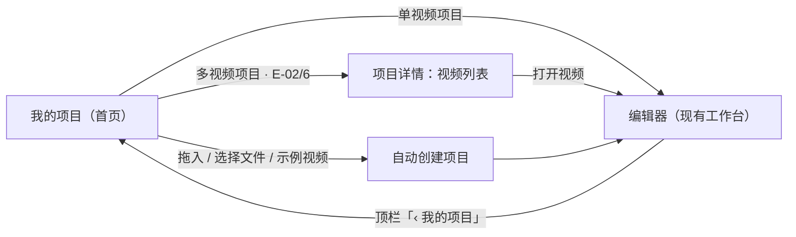
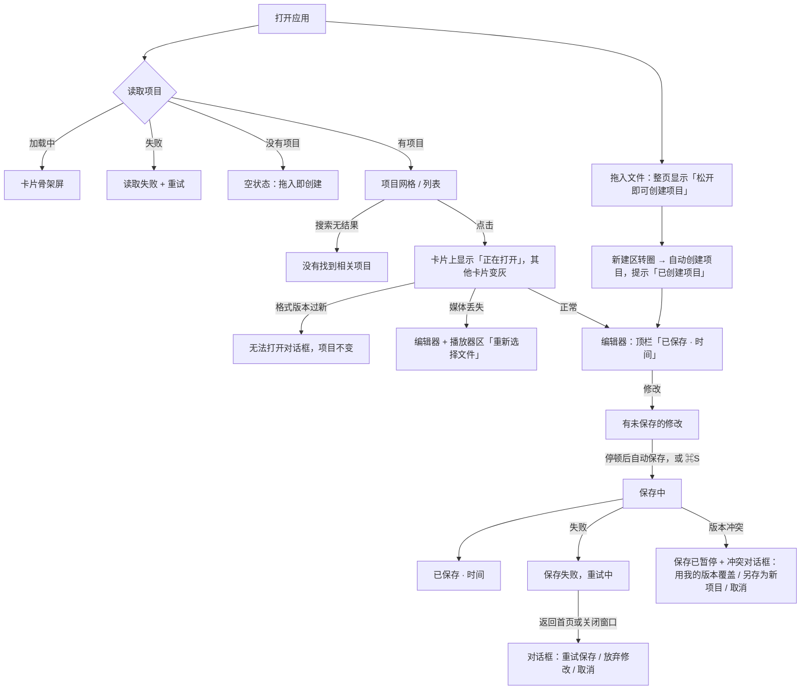

# F-0002 项目数据保存到 Host：交互原型

> 2026-11-05：需求流程取消了交互原型阶段，原型入口（`prototype.html`、`src/prototypes/`）和原型测试已删除。本文件只作为界面状态和交互的记录保留；`src/components/Project/` 的展示组件仍在，开发时按 02-design.md 接入真实数据，界面验收改用 `tests/e2e/features/F-0002.spec.ts`。

## 原型入口

- **打开方式**：`pnpm dev:web`，然后访问 `http://localhost:5173/prototype.html#F-0002`。项目页面不需要 Host；编辑器是真实的工作台，用 `pnpm dev`（同时启动 Host）时可以真的导入和转写。
- **右下角「原型状态」面板**：
  - **范围**：「只看 F-0002」只显示本需求要做的；「含 E-02/6」加上排序、重命名、删除、多视频项目和项目详情页。
  - **页面**：项目首页 / 编辑器，并能直接切到每个状态。
  - **语言**：中文 / English。顶栏「浅色 / 深色」切换主题。
- **可以直接操作**：点项目卡片 → 正在打开 → 进入编辑器（「同事发来的项目」会弹出版本过新，「直播回放 11-02」进入媒体丢失；含 E-02/6 时「口播剪辑工作流分享」进入项目详情）；「选择文件 / 用示例视频试试」演示自动建项目；搜索框可以真的过滤；网格 / 列表可以切换；编辑器顶栏「‹ 我的项目」返回首页。
- **代码位置**：
  - 展示组件：`src/components/Project/`（只接收参数，不调用 Host / RPC，不读写 stores）；
  - 编辑器顶栏插槽：`FlyCutCaption` 的可选参数 `headerSlot` → `WorkstationHeader` 的 `slot`（只是放置位置，不改数据流）；
  - 假数据和状态面板：`src/prototypes/F-0002/`；
  - 文案：`src/locales/{zh_CN,en_US}.ts` 的 `components.project`。

## 信息架构

- **我的项目**：应用的首页。左侧导航（项目、设置），右侧是新建区和项目列表。参考 OpusClip 的项目页：新建入口在最上方，项目以缩略图卡片网格展示。
- **编辑器**：沿用现有工作台，只在顶栏品牌后面加「‹ 我的项目 / 项目名 · 保存状态」。
- **项目详情（E-02/6）**：多视频项目的视频列表，每个视频显示转写状态，可以添加视频。

## 交互流程

## 界面与状态清单

截图在 [screenshots/](screenshots/)，1440×900。

| 界面 | 状态 | 范围 | 原型里怎么看到 | 截图 |
|---|---|---|---|---|
| 我的项目 · 网格 | 有项目（多视频角标、转写进度条、媒体丢失） | F-0002 | 项目首页 → 有项目 | [深色](screenshots/01-home-grid-dark.jpg)、[浅色](screenshots/02-home-grid-light.jpg) |
| | 空（第一次使用） | F-0002 | 空 | [截图](screenshots/03-home-empty.jpg) |
| | 加载中（骨架屏） | F-0002 | 加载中 | [截图](screenshots/04-home-loading.jpg) |
| | 读取失败 + 重试 | F-0002 | 读取失败 | [截图](screenshots/05-home-error.jpg) |
| | 搜索无结果 | F-0002 | 搜索无结果，或在搜索框输入 | — |
| | 拖入文件时（整页遮罩） | F-0002 | 拖入文件时，或真的拖一个文件进来 | [截图](screenshots/06-home-dragging.jpg) |
| | 正在创建（新建区转圈） | F-0002 | 正在创建，或点「选择文件」 | — |
| | 正在打开（其他卡片变灰） | F-0002 | 正在打开，或点任一卡片 | [截图](screenshots/07-home-opening.jpg) |
| | 版本过新，无法打开 | F-0002 | 版本过新 | [截图](screenshots/08-newer-version.jpg) |
| 编辑器 · 顶栏 | 我的项目 / 项目名 · 已保存 · 时间 | F-0002 | 编辑器 → 已保存 | [截图](screenshots/09-editor-saved.jpg) |
| | 有未保存的修改（点击立即保存，悬停提示 ⌘S） | F-0002 | 有未保存修改 | — |
| | 保存中 | F-0002 | 保存中 | — |
| | 保存失败，重试中（点击立即重试） | F-0002 | 保存失败 | [截图](screenshots/10-editor-save-failed.jpg) |
| | 保存已暂停 + 处理冲突（悬停说明原因） | F-0002 | 版本冲突 | 见下 |
| 冲突对话框 | 用我的版本覆盖 / 另存为新项目 / 取消 | F-0002 | 版本冲突 | [截图](screenshots/11-editor-conflict.jpg) |
| 未保存对话框 | 重试保存 / 放弃修改 / 取消；重试时按钮转圈 | F-0002 | 关闭时仍未保存 | [截图](screenshots/12-editor-close-unsaved.jpg) |
| 编辑器 · 播放器区 | 媒体丢失 + 重新选择文件，字幕照常可编辑 | F-0002 | 媒体丢失 | [截图](screenshots/13-editor-media-missing.jpg) |
| 卡片「更多」菜单 | 打开 / 重命名 / 删除 | E-02/6 | 含 E-02/6，悬停卡片点「…」 | [截图](screenshots/14-e0206-card-menu.jpg) |
| 我的项目 · 列表 | 名称、视频数、时长、修改时间、状态 + 排序 | 列表视图 F-0002，排序 E-02/6 | 点右上角列表图标 | [截图](screenshots/15-e0206-list-view.jpg) |
| 删除确认 | 说明会删除几个视频，原始文件不受影响 | E-02/6 | 菜单 → 删除 | [截图](screenshots/16-e0206-delete.jpg) |
| 重命名对话框 | 名称为空或未改动时不能保存 | E-02/6 | 菜单 → 重命名 | — |
| 项目详情 | 视频列表：已转写 / 转写中进度 / 未转写，添加视频 | E-02/6 | 含 E-02/6 → 项目详情 | [深色](screenshots/17-e0206-detail-dark.jpg)、[浅色](screenshots/18-e0206-detail-light.jpg) |

没有截图的状态都在原型里检查过（读取页面文字确认显示内容）。

## 明暗主题与画幅

- 明暗主题都已检查；组件只用现有主题变量（`bg-card`、`text-muted-foreground`、`aimu-*` 等），没有新颜色。
- 本需求不改视频画面，不涉及横屏 / 竖屏 / 方形画幅。
- 项目网格：宽屏 4 列，中等宽度 3 列，窄屏 2 列。

## 文案

键在 `components.project` 下，完整内容见 `src/locales/zh_CN.ts`、`en_US.ts`。主要文案：

| 键 | 中文 | English |
|---|---|---|
| homeTitle / projectCount | 我的项目 / {count} 个项目 | My projects / {count} projects |
| dropTitle | 拖入视频或音频，开始一个新项目 | Drop a video or audio file to start a new project |
| dropActive | 松开即可创建项目 | Release to create a project |
| chooseFile / useSample | 选择文件 / 用示例视频试试 | Choose file / Try a sample video |
| emptyTitle / emptyHint | 还没有项目 / 拖入一个视频或音频，就会自动创建项目，转写和修改都会自动保存。 | No projects yet / Drop a video or audio file to create a project. Transcripts and edits are saved automatically. |
| loadError / loadErrorHint | 读取项目失败 / 没能连接到 FlyCut Host，请稍后重试 | Couldn't load projects / Couldn't reach FlyCut Host. Please try again. |
| backToProjects | 我的项目 | My projects |
| savedAt / pending / saving | 已保存 · {time} / 有未保存的修改 / 保存中… | Saved · {time} / Unsaved changes / Saving… |
| saveFailed / saveConflict | 保存失败，重试中 / 保存已暂停 | Save failed, retrying / Saving paused |
| conflictTitle | 项目已在别处修改 | Project changed elsewhere |
| conflictOverwrite / conflictSaveAsNew | 用我的版本覆盖 / 另存为新项目 | Overwrite with mine / Save as new project |
| unsavedTitle | 还有修改没有保存 | Some changes are not saved |
| mediaMissingTitle / mediaMissingRelocate | 找不到这个项目的视频文件 / 重新选择文件 | Can't find this project's video / Choose file again |
| newerVersionTitle | 无法打开这个项目 | Can't open this project |
| deleteTitle（E-02/6） | 删除项目「{name}」？ | Delete "{name}"? |

## 组件接口

都从 `@/components/Project` 导入，技术设计阶段据此接入真实数据。

| 组件 | 主要参数 | 用在哪里 | 范围 |
|---|---|---|---|
| `ProjectsShell` | `version`、`toolbar?`、`onOpenSettings()`、`children` | 项目相关页面的外框（左侧导航） | F-0002 |
| `ProjectsHome` | `status`、`projects`、`totalCount`、`query` / `onQueryChange`、`view` / `onViewChange`、`openingId?`、`creating?`、`onOpen(id)`、`onFilesDropped(files)`、`onChooseFile()`、`onUseSample()`、`onRetry()`；E-02/6：`sort` / `onSortChange`、`onRename(id)`、`onDelete(id)` | 我的项目 | F-0002（E-02/6 参数不传就不显示） |
| `ProjectCard` | `project`、`opening?`、`disabled?`、`onOpen()`、`onRename?()`、`onDelete?()` | 首页网格 | F-0002 |
| `ProjectBreadcrumb` | `projectName`、`videoName?`、`onBack()` + `SaveStatusIndicator` 的全部参数 | 编辑器顶栏，经 `FlyCutCaption headerSlot` | F-0002 |
| `SaveStatusIndicator` | `status: SaveStatus`、`savedAt?`、`shortcut?`、`onSaveNow()`、`onRetry()`、`onResolveConflict()` | 面包屑里 | F-0002 |
| `SaveConflictDialog` | `open`、`projectName`、`otherSavedAt`、`onOverwrite()`、`onSaveAsNew()`、`onCancel()` | 全局 | F-0002 |
| `UnsavedChangesDialog` | `open`、`retrying?`、`onRetry()`、`onDiscard()`、`onCancel()` | 返回首页或关闭窗口时 | F-0002 |
| `ProjectOpenErrorDialog` | `open`、`projectName`、`onClose()` | 打开项目时 | F-0002 |
| `MediaMissingBanner` | `fileName`、`onRelocate()` | 播放器区域 | F-0002 |
| `ProjectDetail` | `name`、`videos`、`onBack()`、`onOpenVideo(id)`、`onAddVideo()`、`onRename?()` | 项目详情 | E-02/6 |
| `RenameProjectDialog`、`DeleteProjectDialog` | 见源码 | 卡片菜单 | E-02/6 |

数据类型在 `src/components/Project/types.ts`：`ProjectSummary`、`ProjectVideoItem`、`SaveStatus`、`LoadStatus`、`ProjectsView`、`ProjectsSort`。

## 验收标准覆盖

PRD 的 AC-5 已按本阶段的决定改为「我的项目」页面，PRD 需要重新确认。

| AC | 原型中的对应部分 |
|---|---|
| AC-1 | 拖入 / 选择文件 / 示例视频 → 自动创建项目并提示；是否经过 RPC 传路径不涉及界面，见技术设计 |
| AC-2 | 新建后编辑器顶栏从「保存中」到「已保存」；转写本身沿用现有界面 |
| AC-3 | 编辑器顶栏：有未保存的修改 → 保存中 → 已保存 · 时间；⌘S 立即保存 |
| AC-4 | 保存失败，重试中 + 未保存对话框（重试保存 / 放弃修改 / 取消） |
| AC-5 | 我的项目：网格 / 列表、搜索、按修改时间倒序、加载 / 空 / 失败；点击 → 正在打开 → 编辑器；顶栏返回首页 |
| AC-6 | 不涉及新界面，见技术设计 |
| AC-7 | 卡片上的「媒体丢失」+ 编辑器播放器区「重新选择文件」 |
| AC-8 | 版本过新，无法打开对话框；迁移旧版本不涉及界面 |
| AC-9 | 保存已暂停 + 冲突对话框（用我的版本覆盖 / 另存为新项目 / 取消） |
| AC-10 | 原型本身就是 Web 页面，组件两端共用；连接 Host 的验证见技术设计 |

## 原型的限制

- 编辑器是真实的工作台，但原型没有往里面载入项目数据，所以显示的是「未选择文件」的空状态；用 `pnpm dev` 启动 Host 后可以导入视频看完整效果。
- 「媒体丢失」是盖在真实播放器区域上的一层，位置是近似的；实现时由播放器区域自己显示。

## 未决问题

- [x] 1. **左侧导航**：现在只有「项目」和「设置」。以后的模板、品牌预设（E-03）、术语表（E-04）是否也放在这里？本需求先只放这两项。（2026-11-05 维护者确认原型时未提异议，按此处理）
- [ ] 2. **「已保存」的显示**：一直显示「已保存 · 时间」，还是保存成功几秒后淡出、只在有修改或出错时显示？（维护者确认原型时未回答，带到技术设计阶段再问）
- [x] 3. **桌面端打开应用**：总是先进「我的项目」，还是直接回到上次打开的项目？我的建议是先进「我的项目」。（2026-11-05 维护者确认原型时未提异议，按此处理）
