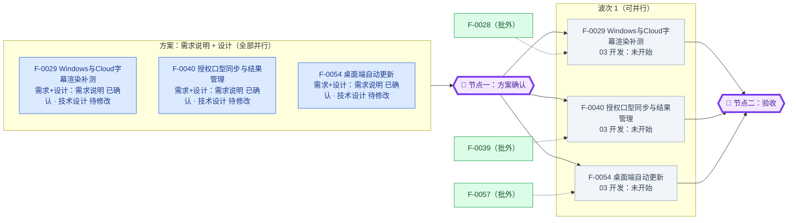

# B-01 剩余设计：跨平台字幕补测、口型同步、桌面自动更新：批次执行计划

> 这个文件是维护者在两个节点唯一需要审阅的地方：「方案确认」（本批次所有需求说明和技术设计一次看完）和「验收」（所有测试报告一次看完）。其余阶段由独立 AI 审查员或脚本检查确认。

## 目标与范围

收尾 Epic 里剩下的三个功能类需求，一次交维护者方案确认：

- F-0029 Windows 与 Linux 无界面环境的字幕渲染实机补测（E-03/7）
- F-0040 授权口型同步与结果管理（E-05/7）
- F-0054 桌面端自动更新（E-08）

放在一起的原因：三者的需求说明都已确认，依赖（F-0028、F-0039、F-0057）都已完成，只差设计；而且都卡在外部条件上（Windows 实机与无界面 Linux、Sync.so 账号与授权素材、更新签名密钥与 GitHub Environment），适合一次决定。

不包含：F-0022 字词时间戳校准。它的设计已记录「不实施」（F-0001 调研没有独立时间真值，也没有确认可用的 align 模型），见下面「待澄清的问题」Q-0。

## 执行图

<!-- 由 pnpm feature batch sync 生成，不要手改 -->
<!-- batch:graph:start -->

图例：灰色 未开始 · 蓝色 进行中 · 琥珀 等待确认（AI 或维护者） · 绿色 已完成 · 红色 被依赖阻塞 · 紫色 维护者确认节点
<!-- batch:graph:end -->

## 进度

<!-- batch:progress:start -->
完成 0 / 3 个需求

| 需求 | 类型 | 波次 | 依赖 | 当前阶段 | 状态 | AI 审查 | 下一步 |
|---|---|---|---|---|---|---|---|
| F-0029 Windows与Cloud字幕渲染补测 | 功能 | 1 | F-0028 | 02-design 技术设计 | draft | fail（deepseek-v4.1-flash-reviewer） | 02-design.md 的 AI 审查未通过：两轮未通过：第2轮遗留（Cargo target 表、debug 测试构建、F-0058 依赖、批次冲突、AC-5 状态锚点）已由主会话修正并经第3次核对，剩余 AC 语义与拆分问题交维护者，见 B-01。修改后重新 pnpm feature ai-review F-0029 --by <审查员>，再 pnpm feature review F-0029 |
| F-0040 授权口型同步与结果管理 | 功能 | 1 | F-0039 | 02-design 技术设计 | draft | fail（deepseek-v4.1-flash-reviewer） | 02-design.md 的 AI 审查未通过：两轮未通过：确认门可信来源在现有架构下不成立（RPC 无调用方通道），交维护者在 (a)/(b)/(c) 中选择；其余第2轮项已由主会话修正并经第3次核对，见 B-01。修改后重新 pnpm feature ai-review F-0040 --by <审查员>，再 pnpm feature review F-0040 |
| F-0054 桌面端自动更新 | 功能 | 1 | F-0057 | 02-design 技术设计 | draft | fail（deepseek-v4.1-flash-reviewer） | 02-design.md 的 AI 审查未通过：两轮未通过：第2轮遗留（AI 密钥真实存储、fail-closed 读取、门禁数据源、Web 标注、英文文案、安装失败恢复、HTTPS spike）已由主会话修正并经第3次核对，剩余为维护者项，见 B-01。修改后重新 pnpm feature ai-review F-0054 --by <审查员>，再 pnpm feature review F-0054 |
<!-- batch:progress:end -->

## 并发与分派

| 波次 | 需求 | 分支 / worktree | 执行者 | 合入顺序 | 备注 |
|---|---|---|---|---|---|
| 1 | F-0029 | `codex/f0029-subtitle-validation`（独立 worktree） | 主会话拆任务；脚本与测试派 DeepSeek 子代理 | 1（F-0054 合入后由 F-0054 重跑 Windows 包检查） | 若确认拆分，F-0029a（Linux）先行，F-0029b（Windows）待实机 |
| 1 | F-0040 | `codex/f0040-lipsync`（独立 worktree） | 主会话负责确认门与契约；插件、面板、测试派 DeepSeek 子代理 | 3（`shared/protocol.ts`、`server/profile.ts` 最后合入，按当前代码重基） | 真实服务步骤等 F-0039 试点结论 |
| 1 | F-0054 | `codex/f0054-auto-update`（独立 worktree） | 主会话负责发版流水线与安全相关文件；界面与脚本派 DeepSeek 子代理 | 2 | `tauri.conf.json`、`capabilities/**`、`release.yml` 改动需维护者放行（code-standards 第 6 条） |

重叠文件：`src-tauri/Cargo.toml` 与 `src-tauri/src/lib.rs`（F-0029、F-0054）；`server/plugins/export.ts`（F-0040 抽出 probe 函数，F-0029 可能修 Windows 句柄清理）；`shared/protocol.ts`、`server/profile.ts`（F-0040）。三者都在独立 worktree，合入顺序建议 F-0029 → F-0054 → F-0040，后合者在当前代码上重基。

## 节点一：方案确认

### 每个需求一句话方案

- **F-0029**（9 条 AC）：用 macOS Host 生成参考条带，在 Windows 安装包 / WebView2 与无桌面、无 GPU、无中文系统字体的 Linux x86_64 Host 上做三层比较（换行、包围盒、像素），新增字体 SHA-256 清单、Windows WebDriver 入口（扩展 `tauri-plugin-wdio-webdriver` 到 Windows 的 debug 测试构建）与三个验收脚本；缺实机的项写 Not run，不用模拟浏览器代替。估计 14–23 人日，**超过两周**。
- **F-0040**（9 条 AC）：新增 `lipsync` 插件与 Sync.so `lipsync-2` Provider 插件，按 EDL 投影生成预览、逐次授权确认后提交，记录存 `lipsync/records.json`，结果用内置 FFmpeg 校验，删除只删本地并说明远端保留；先从 `dubbing.ts` 抽出 `mixDubbingTrack`、从 `export.ts` 抽出 probe。按建议方向 (a) 估计 12–16 天，**超过两周**。
- **F-0054**（9 条 AC）：用 Tauri 官方 updater 插件 + GitHub Release 静态 `latest.json`，独立 updater 密钥只在 `updater-sign` 作业（environment: release）注入；整包替换（Host、FFmpeg 随包同版本）；安装前门禁读 `jobs.list`、上传定位、任务定位、恢复副本，任一读取失败即禁止安装；新增 1 个只停 Host 的 Tauri 命令 `update_stop_host`。约 11 天；若插件不能中止下载需 +3–4 天，届时拆分。

### 待澄清的问题与建议答案

**Q-0（F-0022）** 字词时间戳校准按 2026-11-17 的设计结论正式关闭、不实施？建议：是。在 E-01 候选表标「不实施」，目录移入 `docs/features/archive/`；以后拿到独立时间标注和可用 align 模型再重新立项。（流程脚本没有「关闭」命令，需要维护者同意后手工处理。）

**需要先拍板、会改变设计或规模的：**

1. **F-0040 能否在 F-0039 试点之前开工？** F-0039 的结论是「没有试点证据前不能进 F-0040 实现」。建议：契约、确认门、Host 状态机与假服务可以先做；真实服务调用、质量判定和发布等试点结论。
2. **F-0040 确认门的可信来源（AI 审查两轮未解决）。** 已核实：现有 RPC handler 拿不到调用方通道，桌面界面和 CLI/MCP 用同一种 bearer，`confirmations.decide` 的 `actor` 由调用方自填，所以 Agent 可以自己 create + decide 绕过「本人确认」。选项：(a) 新增仅本机界面持有的批准通道，Gateway 把 `caller` 传给 handler（改 `server/plugins/gateway.ts`、`server/plugins/rpc.ts`，共用契约）；(b) 接受「持 bearer 即本人」，书面接受与 decisions.md 的冲突；(c) 只在界面开放口型同步，不进 MCP/CLI 工具清单。建议 (a)。
3. **拆分。** F-0029 建议拆为 F-0029a（Linux 无界面）/ F-0029b（Windows）；F-0040 选 (a) 时建议拆为 F-0040a（契约、可信确认通道、状态机、假服务）/ F-0040b（真实服务、结果管理、界面）；F-0054 只在插件不能中止下载时拆。建议：按此拆，回 Epic 更新候选表。
4. **F-0040 AC-3「保存为新视频」**：设计改成源视频下的产物，备选是 `projects.addVideo` 新建视频。建议：产物附属源视频（AC 语义变更，需确认）。
5. **F-0040 成片 AI 标注**：decisions.md 要求「成片默认标注 AI 配音」，设计只写元数据与面板标注。建议：按 decisions.md 加画面角标，标注文案「AI 口型同步」。
6. **F-0029 AC-1 测试对象**：spec 写「真实 Windows WebView2 安装包」，设计改为同提交的 debug WebDriver 测试构建（正式包不含驱动）；安装包本身的检查由 AC-2 脚本做。建议：接受。
7. **F-0029 AC-5 导出「排队」「取消」**：现有界面没有这两个状态（`ExportDialog` 的「取消」只关对话框，Host 没有导出并发上限）。建议：本需求只复测现有 7 个状态；排队与取消另立需求。
8. **F-0054 AC-5「暂无内容」与 AC-7「第二个客户端读取一致」**：设计判为不适用 / 收窄为本机重启后版本检查。建议：接受。
9. **depends_on 补 F-0058**：F-0029 与 F-0054 都依赖 F-0058 的驱动与 `acceptance:bundle`。建议：补（已验收，不影响排期）。

**F-0029 其他：** 「动画」按多条 cue 切换导出解释；AC-1 指标口径（每画幅 ≥3 次 60 s，掉帧最大 <1%；≥30 次拖动 p95 ≤100 ms）；像素阈值（换行一致、包围盒 ≤2 px、alpha IoU ≥0.98、RGBA MAE ≤2/255）；Cloud 由 Linux 无界面 Host 代表；签名不纳入（用未签名本地包）；Windows 上 Arial/Georgia 由 Host 注册系统字体文件修复；字体哈希首次下载后入库并固定上游提交。建议：全部按设计建议。

**F-0040 其他：** 首个服务 Sync.so `lipsync-2`（内置插件，备选 HeyGen）；支持矩阵为单人正面、中文或英文配音，10 分钟上限（来自 F-0039 试点预算，非已确认矩阵）；单次估价超过 $30 二次确认；`unknown` 结果未核对前阻止同一输入，核对后转 `closed-unverified` 并允许带重复计费提示的新提交；按 EDL 投影时间线预览与提交；密钥沿用 302.ai 的环境变量 + 钥匙串模式（或改用 aiSettings 密钥存储）。建议：全部按设计建议，密钥改用现有 aiSettings 存储。

**F-0054 其他：** 更新清单托管在本仓库 GitHub Release 的 `latest.json`；独立 updater 密钥，私钥放新建的 GitHub Environment `release`（required reviewers、只限 `v*` 标签）并离线备份；2.0.2 及更早版本需要一次手动安装过渡（写进发布说明）；Windows 用 NSIS `-setup.exe` + passive；取消下载先用插件能力，不行再评估自写流式下载（备选 B，新增安全面）；v1 不做更新前自动备份、不做 Host 排空接口、不新增 `uploads.list`（Host 侧他端上传会话作为已知风险）。建议：全部按设计建议。

### 产品文档与 Epic 改动

- 若同意 Q-0：E-01 候选表 E-01/6（F-0022）标「不实施」。
- 若同意拆分（问题 3）：E-03、E-05、E-08 候选表把 F-0029 / F-0040 拆成两行，编号由 `pnpm feature new` 分配。
本批次尚未改动任何产品文档，等维护者答复后再改。

### 新写的 ADR（proposed）

本批次没有新建 ADR。F-0040 提议两份（口型同步存储格式；Provider 接收视频输入的边界例外，参照 ADR-0015）；F-0029 验收后提议更新 ADR-0006 的验证范围；F-0054 是否为「updater 密钥与发版流水线」单写 ADR 留给维护者。确认后用 `pnpm feature adr` 创建。

### AI 审查结论

三份设计都由 DeepSeek 子代理起草，另起子代理独立审查，**两轮都没通过**；第 2 轮遗留的具体问题由主会话修正，再由第三个子代理逐条核对代码。按流程，两轮不过的结论如实记为 `fail`，交维护者决定，而不是把主会话自己的修正记成通过。

- **F-0029**：已修正 Windows WebDriver 前提（Cargo target 表只有 macOS、注册条件含 `debug_assertions`，必须 debug 构建并复用 `tauri.acceptance.conf.json`）、批次冲突、AC-5 状态锚点（运行/完成在 `TimelineWaveform` 与消息中心，失败在消息中心）、事实引用。**未解决：** 只剩上面问题 3、6、7、9 和「F-0029 其他」里的口径问题。待核实：`tauri-plugin-wdio-webdriver` 是否支持 WebView2（实现第 3 项先做可行性验证）。
- **F-0040**：已修正界面状态与中英文案、授权逐次确认、`confirmations` 契约 6 处改动、probe 用内置 FFmpeg、BUILTINS 登记、验证命令归属、规模重算。**未解决（关键）：** 确认门可信来源（问题 2），在维护者选择前 AC-1 的覆盖不成立。待核实：Sync 409 返回内容、结果地址有效期、上传上限、取消与删除接口、F-0023 备份是否包含 `lipsync/`。
- **F-0054**：已修正 AI 密钥真实存储（桌面默认走钥匙串 / DPAPI，不是 `ai-secrets.enc`）、门禁用不吞异常的读取并覆盖四种任务定位、未保存编辑用 `projects.open` 比较、安装失败后恢复 Host、重试先读版本、HTTPS 测试端点进 spike、英文文案。**未解决：** 只剩维护者项。待核实（实现第 1 项 spike）：插件忽略 `size`、`download()` 能否中止、signer 私钥变量名、测试构建连 `http://localhost` 的开关、Windows `installMode` 配置位置。

三份设计的 frontmatter 仍为 `02-design draft` / `ai_review: fail`，所以 `batch status` 显示 planning 而不是 plan-review。维护者同意按上面答复后：把答案写回设计，重新跑一次独立 AI 审查，通过后 `pnpm feature review`，再 `pnpm feature approve B-01 --by <维护者>`。

## 节点二：验收

### 每个需求的结论

<!-- 每个需求：可以发布 / 需要修复后重测，来自测试报告 -->

### Not run 与原因

<!-- 没有跑的检查、原因和补验步骤 -->

### 请确认的事项

<!-- 需要维护者拍板的事项 -->

### AI 已确认的事项（调研结论、自行决定的事项）

<!-- 调研结论、开发和测试阶段 agent 自己决定的事，逐条：决定了什么、为什么、影响哪条 AC -->

## 同步日志

| 日期 | 事件 |
|---|---|
| 2026-11-19 | 建批次；三份设计两轮 AI 审查未通过，遗留问题由主会话修正并核对，交节点一 |
